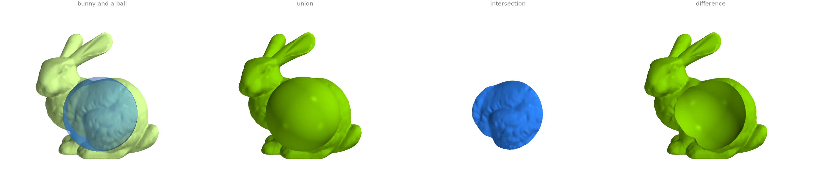
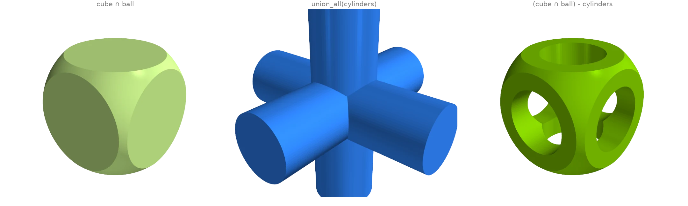
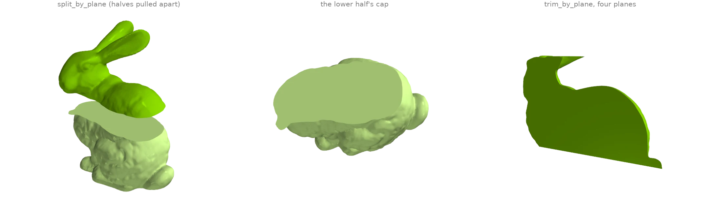
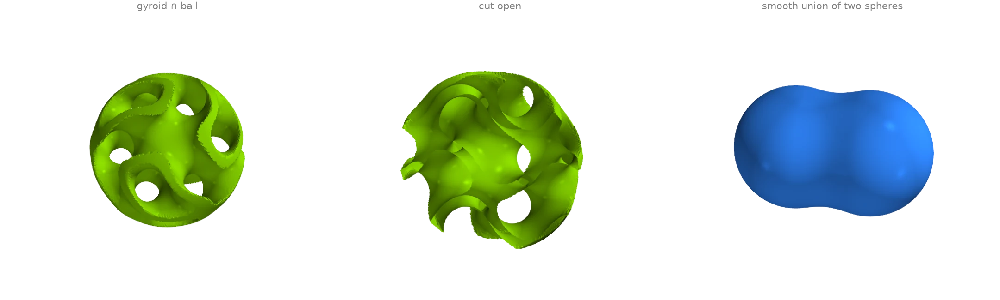
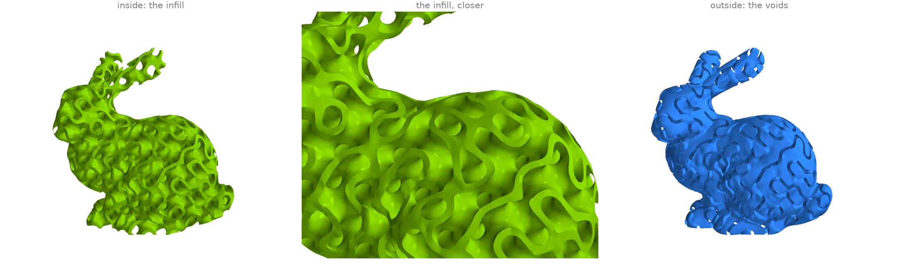
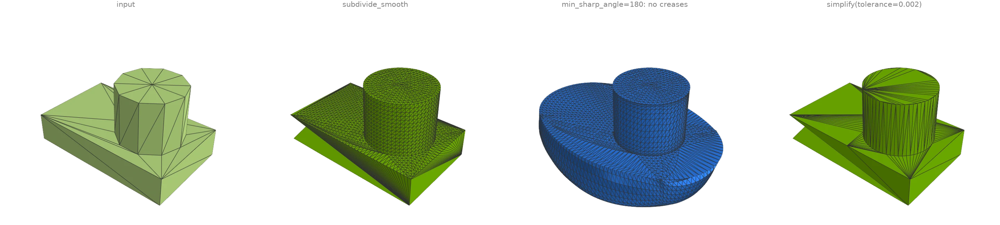
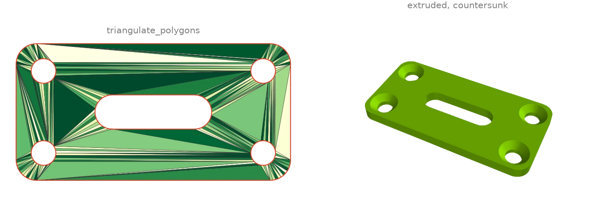
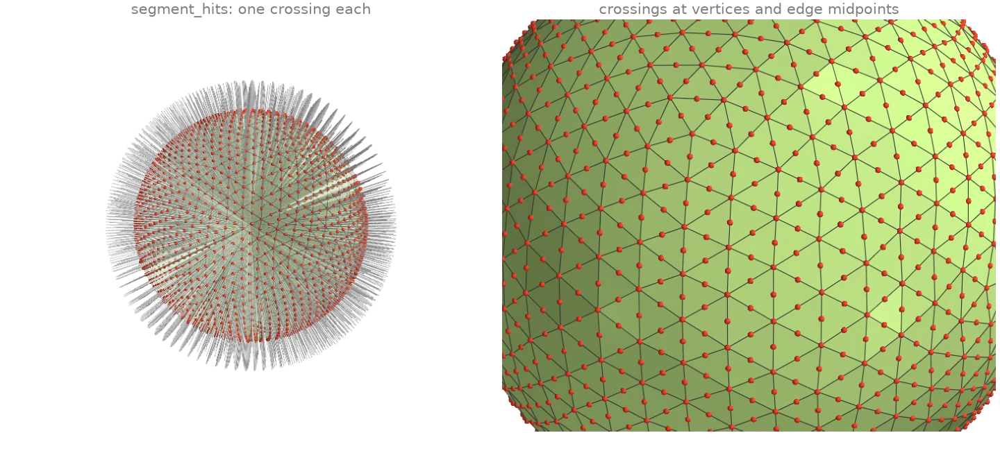

# Solids and Booleans

Exact Booleans of closed meshes, CSG trees, capped cuts, implicit solids, smooth refinement that
keeps creases, polygons with holes and exact segment crossings.

Every function on this page takes and returns *closed, consistently wound* meshes and treats them
as solids. They are a port of the [Manifold](https://github.com/elalish/manifold) library, the
engine behind [`trimesh.boolean`][] and `manifold3d`: every crossing of an edge with a face and
every inside/outside decision is an exact sign computed from the `float32` coordinates, ties
(touching or coplanar surfaces) are broken by one consistent symbolic perturbation, and so the
result is always closed and manifold, the same mesh Manifold returns. A mesh that is not closed
raises `ValueError`; [`make_solid`][ordito.repair.make_solid] repairs one first, and the
[voxel route](volumes.md#v6) combines shapes that are not solids at all.

## Union, intersection and difference {#b1}

[`union`][ordito.boolean.union], [`intersection`][ordito.boolean.intersection] and
[`difference`][ordito.boolean.difference] combine two closed meshes as solids: here the
Stanford bunny, closed into a solid by [`make_solid`][ordito.repair.make_solid], and a ball
sunk into its flank. Each result is again
a valid volume ([`is_volume`][ordito.validation.is_volume]: every edge shared by two faces,
consistently wound, outward), so it can go straight into the next Boolean, a volume, a ray
test or a print. The volumes obey inclusion-exclusion to within the `float32` rounding of
the new vertices, and each result is the very mesh `manifold3d` returns for the same
inputs: the same vertex and triangle arrays, bit for bit.

```python
import manifold3d as m3
import numpy as np
import warp as wp

import ordito as od
from examples import data

def to_manifold(vertices: wp.array[wp.vec3], faces: wp.array[wp.int32]) -> m3.Manifold:
    triangles = faces.numpy().reshape(-1, 3).astype(np.uint32)
    return m3.Manifold(m3.Mesh(vert_properties=vertices.numpy(), tri_verts=triangles))

def from_manifold(solid: m3.Manifold) -> tuple[wp.array[wp.vec3], wp.array[wp.int32]]:
    mesh = solid.to_mesh()
    vertices = wp.array(np.asarray(mesh.vert_properties)[:, :3], dtype=wp.vec3, device=device)
    return vertices, wp.array(np.asarray(mesh.tri_verts).ravel(), dtype=wp.int32, device=device)

# The bunny scan has holes; make_solid closes it into a valid input. Manifold also drops a
# mesh's degenerate triangles when it builds a solid, so both libraries start from its copy.
solid_a = to_manifold(*od.repair.make_solid(*data.load("bunny", device)))
bunny = from_manifold(solid_a)
print(
    f"bunny solid: {bunny[1].shape[0] // 3} triangles, valid {od.validation.is_volume(*bunny)}"
)

lower, upper = bunny[0].numpy().min(axis=0), bunny[0].numpy().max(axis=0)
middle = (lower + upper) / 2
centre = [middle[0] + 0.01, lower[1] + 0.4 * (upper[1] - lower[1]), upper[2] - 0.01]
ball = od.creation.icosphere(subdivisions=5, radius=0.045, device=device)
ball = od.transform.transform_mesh(*ball, od.transform.translation_matrix(centre))
solid_b = to_manifold(*ball)

results = {
    "union": od.boolean.union(*bunny, *ball),
    "intersection": od.boolean.intersection(*bunny, *ball),
    "difference": od.boolean.difference(*bunny, *ball),
}
reference = {
    "union": solid_a + solid_b,
    "intersection": solid_a ^ solid_b,
    "difference": solid_a - solid_b,
}
for name, (vertices, faces) in results.items():
    valid = od.validation.is_volume(vertices, faces)
    vertices_m3, faces_m3 = from_manifold(reference[name])
    same = np.array_equal(vertices.numpy(), vertices_m3.numpy())
    same &= np.array_equal(faces.numpy(), faces_m3.numpy())
    print(f"{name:>12}: {faces.shape[0] // 3:>6} triangles, solid {valid}, manifold3d's {same}")

volume = {name: od.measures.volume(*mesh) for name, mesh in results.items()}
excess = volume["union"] + volume["intersection"]
excess -= od.measures.volume(*bunny) + od.measures.volume(*ball)
print(f"inclusion-exclusion holds to {abs(excess) / volume['union']:.0e} of the volume")
```

```text title="Output"
bunny solid: 69658 triangles, valid True
       union:  75212 triangles, solid True, manifold3d's True
intersection:  18362 triangles, solid True, manifold3d's True
  difference:  69588 triangles, solid True, manifold3d's True
inclusion-exclusion holds to 9e-08 of the volume
```



Timings against `manifold3d`, MeshLib, PyMeshLab and trimesh are on the
[boolean benchmarks](../benchmarks/boolean.md) page.

Modelled on: [trimesh: boolean](https://trimesh.org/trimesh.boolean.html) · [Manifold: Boolean](https://manifoldcad.org/docs/html/classmanifold_1_1_manifold.html) · [libigl 609 (CSG)](https://libigl.github.io/tutorial/#boolean-operations-on-meshes)
{: .ordito-credits }

## A CSG tree {#b2}

The textbook constructive-solid-geometry part: a cube intersected with a ball, less three
cylinders along the axes. [`union_all`][ordito.boolean.union_all] joins the cylinders in
one call and [`difference_all`][ordito.boolean.difference_all] subtracts a whole list from
the first mesh, grouping the operands the way Manifold's batch Boolean does: the same solid
as the pairwise route, its new vertices rounded along a different path. Every intermediate
result is a closed solid, and
the topology comes out exactly: three bores crossing at the centre leave a surface of
genus 5, read off the Euler characteristic.

```python
import ordito as od

cube = od.creation.box(extents=(2.0, 2.0, 2.0), device=device)
ball = od.creation.icosphere(subdivisions=6, radius=1.35, device=device)
axes = ([[-2.0, 0.0, 0.0], [2.0, 0.0, 0.0]], [[0.0, -2.0, 0.0], [0.0, 2.0, 0.0]])
axes += ([[0.0, 0.0, -2.0], [0.0, 0.0, 2.0]],)
cylinders = [od.creation.cylinder(0.6, segment=a, sections=96, device=device) for a in axes]

rounded = od.boolean.intersection(*cube, *ball)
cross = od.boolean.union_all(cylinders)
part = od.boolean.difference(*rounded, *cross)
in_one_call = od.boolean.difference_all([rounded, *cylinders])

vertices, faces = part
genus = (2 - od.measures.euler_characteristic(faces)) // 2
print(f"part: {faces.shape[0] // 3} triangles, solid {od.validation.is_volume(*part)}")
print(f"volume {od.measures.volume(*part):.4f}, genus {genus}")
alike = od.measures.volume(*in_one_call) / od.measures.volume(*part)
print(f"difference_all: {in_one_call[1].shape[0] // 3} triangles, volume ratio {alike:.6f}")
```

```text title="Output"
part: 25650 triangles, solid True
volume 3.1180, genus 5
difference_all: 25650 triangles, volume ratio 1.000000
```



Modelled on: [Wikipedia: constructive solid geometry](https://en.wikipedia.org/wiki/Constructive_solid_geometry) · [libigl 609 (CSG)](https://libigl.github.io/tutorial/#boolean-operations-on-meshes) · [trimesh: boolean](https://trimesh.org/trimesh.boolean.html)
{: .ordito-credits }

## Capped cuts by a plane {#b3}

[`split_by_plane`][ordito.boolean.split_by_plane] cuts a solid into the two solids on
either side of a plane, each capped where the plane passes, so the two volumes add up to
the whole; [`trim_by_plane`][ordito.boolean.trim_by_plane] keeps one side. The cut is
exact, the same mesh as a [`difference`][ordito.boolean.difference] with a large box beyond
the plane. Compare [`slice_mesh_with_plane`][ordito.intersection.slice_mesh_with_plane],
which cuts any surface, closed or not, but leaves the section open. Here the bunny, closed
into a solid by [`make_solid`][ordito.repair.make_solid], is sliced in half and then
trimmed by four planes into a slab.

```python
import warp as wp

import ordito as od
from examples import data

bunny = od.repair.make_solid(*data.load("bunny", device))  # the scan, closed into a solid
total = od.measures.volume(*bunny)
lower, upper = bunny[0].numpy().min(axis=0), bunny[0].numpy().max(axis=0)
middle = float((lower[1] + upper[1]) / 2)

above, below = od.boolean.split_by_plane(*bunny, (0.0, 1.0, 0.0), middle)
halves = od.measures.volume(*above) + od.measures.volume(*below)
closed = od.validation.is_volume(*above), od.validation.is_volume(*below)
print(f"halves are solids: {closed}")
print(f"their volumes add up to the whole within {abs(halves - total) / total:.0e}")

# The open cut: same plane, one side kept, no cap.
open_half = od.intersection.slice_mesh_with_plane(
    *bunny, wp.vec3(0.0, 1.0, 0.0), wp.vec3(0.0, middle, 0.0)
)
print(f"slice_mesh_with_plane's half is a solid: {od.validation.is_volume(*open_half)}")

# A slab through the body: four trims, each a closed solid. A plane is a normal and its
# offset along it, and trim_by_plane keeps the side the normal points to.
centre = float((lower[2] + upper[2]) / 2)
slab = bunny
for normal, offset in (
    ((0.0, 1.0, 0.0), float(lower[1] + 0.2 * (upper[1] - lower[1]))),
    ((0.0, -1.0, 0.0), -float(lower[1] + 0.8 * (upper[1] - lower[1]))),
    ((0.0, 0.0, 1.0), centre - 0.008),
    ((0.0, 0.0, -1.0), -(centre + 0.008)),
):
    slab = od.boolean.trim_by_plane(*slab, normal, offset)
print(f"slab: {slab[1].shape[0] // 3} triangles, solid {od.validation.is_volume(*slab)}")
```

```text title="Output"
halves are solids: (True, True)
their volumes add up to the whole within 5e-07
slice_mesh_with_plane's half is a solid: False
slab: 10064 triangles, solid True
```



Modelled on: [trimesh: slice_plane](https://trimesh.org/trimesh.intersections.html) · [Manifold: split_by_plane](https://manifoldcad.org/docs/html/classmanifold_1_1_manifold.html) · [PyVista: clip with plane](https://docs.pyvista.org/examples/01-filter/clipping)
{: .ordito-credits }

## Solids from a signed distance function {#b4}

[`function_level_set`][ordito.levelset.function_level_set] meshes the region where a
function of position is positive, straight from a `@wp.func`, with no grid for you to
allocate: the function is sampled on a body-centred cubic lattice and the surface is cut
out of its tetrahedra, with grid points near the surface snapped onto it. The result is a
closed, outward-wound solid ready for the Booleans. Here a gyroid sheet, thickened and
clipped to a ball by taking the minimum of the two functions, gives a porous lattice; a
smooth blend of two spheres, the second shape, checks the volume against the exact one of
a single sphere.

```python
import math

import warp as wp

import ordito as od

@wp.func
def gyroid_ball(p: wp.vec3d) -> wp.float64:
    q = wp.float64(5.0) * p
    sheet = wp.sin(q[0]) * wp.cos(q[1]) + wp.sin(q[1]) * wp.cos(q[2])
    sheet += wp.sin(q[2]) * wp.cos(q[0])
    thick = wp.float64(0.45) - wp.abs(sheet)  # positive inside the thickened sheet
    return wp.min(thick, wp.float64(1.0) - wp.length(p))  # ... and inside the unit ball

bounds = [-1.1, -1.1, -1.1, 1.1, 1.1, 1.1]
lattice = od.levelset.function_level_set(gyroid_ball, bounds, edge_length=0.02, device=device)
print(
    f"gyroid ball: {lattice[1].shape[0] // 3} triangles, "
    f"solid {od.validation.is_volume(*lattice)}"
)
print(f"it fills {od.measures.volume(*lattice) / (4 / 3 * math.pi):.0%} of the ball")

@wp.func
def blended_spheres(p: wp.vec3d) -> wp.float64:
    a = wp.float64(0.5) - wp.length(p - wp.vec3d(-0.3, 0.0, 0.0))
    b = wp.float64(0.5) - wp.length(p - wp.vec3d(0.3, 0.0, 0.0))
    k = wp.float64(0.2)  # blend width: a smooth maximum of the two
    h = wp.clamp(
        wp.float64(0.5) + wp.float64(0.5) * (a - b) / k, wp.float64(0.0), wp.float64(1.0)
    )
    return b + (a - b) * h + k * h * (wp.float64(1.0) - h)

blend = od.levelset.function_level_set(
    blended_spheres,
    [-1.0, -0.7, -0.7, 1.0, 0.7, 0.7],
    edge_length=0.02,
    tolerance=1e-5,
    device=device,
)
sphere = 4 / 3 * math.pi * 0.5**3
print(f"blend: {od.measures.volume(*blend) / sphere:.2f} times one sphere's volume")
```

```text title="Output"
gyroid ball: 319820 triangles, solid True
it fills 29% of the ball
blend: 1.83 times one sphere's volume
```



The function need not be a true distance, nor even continuous: only its sign and, near the
surface, its values matter. `tolerance` refines each vertex by root finding along its
lattice edge, which helps where the function is far from linear across a cell. Each new
`@wp.func` compiles its own kernels the first time it is used. For a field already sampled
on a grid, use [`marching_cubes`][ordito.levelset.marching_cubes] instead ([V3](volumes.md#v3)).

Modelled on: [Manifold: level_set](https://manifoldcad.org/docs/html/classmanifold_1_1_manifold.html) · [PyVista: gyroid](https://docs.pyvista.org/examples/00-load/create_parametric_geometric_objects) · [Inigo Quilez: distance functions](https://iquilezles.org/articles/distfunctions/)
{: .ordito-credits }

## Lattice infill: splitting a solid by another {#b5}

[`split_by_mesh`][ordito.boolean.split_by_mesh] cuts one solid by another and returns
both pieces at once: the part inside the cutter, the
[`intersection`][ordito.boolean.intersection], and the part outside, the
[`difference`][ordito.boolean.difference], at the cost of one Boolean. The cutter here is a
gyroid lattice grown over the bunny's bounding box with
[`function_level_set`][ordito.levelset.function_level_set], and the bunny is the scan closed
into a solid by [`make_solid`][ordito.repair.make_solid]; inside the lattice is the infill a
3D printer would lay down, outside it the voids. The two volumes add up to the bunny's.

```python
import warp as wp

import ordito as od
from examples import data

bunny = od.repair.make_solid(*data.load("bunny", device))  # the scan, closed into a solid
lower, upper = bunny[0].numpy().min(axis=0) - 0.002, bunny[0].numpy().max(axis=0) + 0.002

@wp.func
def gyroid(p: wp.vec3d) -> wp.float64:
    q = wp.float64(260.0) * p  # a cell about a sixth of the bunny's height
    sheet = wp.sin(q[0]) * wp.cos(q[1]) + wp.sin(q[1]) * wp.cos(q[2])
    sheet += wp.sin(q[2]) * wp.cos(q[0])
    return wp.float64(0.5) - wp.abs(sheet)

lattice = od.levelset.function_level_set(
    gyroid, [*lower, *upper], edge_length=0.001, device=device
)
inside, outside = od.boolean.split_by_mesh(*bunny, *lattice)

whole = od.measures.volume(*bunny)
infill, voids = od.measures.volume(*inside), od.measures.volume(*outside)
print(f"lattice: {lattice[1].shape[0] // 3} triangles")
print(f"infill: {inside[1].shape[0] // 3} triangles, {infill / whole:.0%} of the volume")
print(f"voids: {outside[1].shape[0] // 3} triangles, {voids / whole:.0%} of the volume")
print("both solids:", od.validation.is_volume(*inside) and od.validation.is_volume(*outside))
```

```text title="Output"
lattice: 4260228 triangles
infill: 1120154 triangles, 33% of the volume
voids: 1142826 triangles, 67% of the volume
both solids: True
```



Modelled on: [Manifold: split](https://manifoldcad.org/docs/html/classmanifold_1_1_manifold.html) · [trimesh: boolean](https://trimesh.org/trimesh.boolean.html)
{: .ordito-credits }

## Smooth refinement that keeps creases, and simplification {#b6}

[`subdivide_smooth`][ordito.remesh.subdivide_smooth] refines a closed mesh onto a smooth
surface that passes through its vertices: each edge becomes a curve leaving its ends along
the tangent planes, each face a patch between them. Edges whose faces meet at more than
`min_sharp_angle` stay creases, and regions of coplanar triangles stay flat, so a part built
from a box and a coarse ten-sided cylinder keeps its edges while the cylinder's facets become
round; with no creases at all (`min_sharp_angle=180`) the whole part swells into one smooth
body. `length` splits each edge into pieces of about that length, `n` splits every edge into
that many, and `tolerance` refines curved regions more than flat ones.
[`simplify`][ordito.remesh.simplify] goes the other way: it removes the vertices that do not
shape the surface, those inside flat regions or along straight edges, moving the surface by
at most its `tolerance`. Here it takes the refined part from 8 476 triangles to 254 and leaves
the round boss round, since a straight line runs down each of its sides.

```python
import ordito as od

# A plate with a coarse ten-sided boss: creases everywhere, and facets that should be round.
plate = od.creation.box(extents=(2.0, 1.2, 0.4), device=device)
boss = od.creation.cylinder(
    0.45, segment=[[0.4, 0.0, 0.0], [0.4, 0.0, 0.9]], sections=10, device=device
)
part = od.boolean.union(*plate, *boss)
creased = od.remesh.subdivide_smooth(*part, length=0.05)
rounded = od.remesh.subdivide_smooth(*part, length=0.05, min_sharp_angle=180.0)
print(f"input: {part[1].shape[0] // 3} triangles")
print(f"creases kept: {creased[1].shape[0] // 3} triangles")
print(f"all smooth: {rounded[1].shape[0] // 3} triangles")

# Simplify: back down, within a tolerance of the refined surface.
coarse = od.remesh.simplify(*creased, tolerance=0.002)
gap = od.metrics.hausdorff_mesh_to_mesh(*coarse, *creased)
print(f"simplified: {coarse[1].shape[0] // 3} triangles, Hausdorff distance {gap:.4f}")

# A box subdivided three times has 386 vertices, all but 8 redundant.
box = od.creation.box(extents=(1.0, 1.0, 1.0), device=device)
for _ in range(3):
    box = od.remesh.subdivide(*box)
plain = od.remesh.simplify(*box)
print(f"subdivided box: {box[0].shape[0]} vertices -> simplified: {plain[0].shape[0]}")
```

```text title="Output"
input: 54 triangles
creases kept: 8476 triangles
all smooth: 8476 triangles
simplified: 254 triangles, Hausdorff distance 0.0000
subdivided box: 386 vertices -> simplified: 8
```



Modelled on: [Manifold: smooth_out and refine](https://manifoldcad.org/docs/html/classmanifold_1_1_manifold.html) · [PyVista: subdivide](https://docs.pyvista.org/examples/01-filter/subdivide)
{: .ordito-credits }

## Polygons with holes, extruded and countersunk {#b7}

[`triangulate_polygons`][ordito.polyline.triangulate_polygons] fills a planar region given
as loops: outer boundaries counter-clockwise, holes clockwise, all triangulated together
and no point added, so every triangle indexes the input points. It is Manifold's
triangulator, robust to loops that touch or come within `epsilon` of each other.
[`triangulate_polygons_from_offsets`][ordito.polyline.triangulate_polygons_from_offsets]
takes the same loops packed into one array with offsets, the form a GPU pipeline produces.
[`extrude_triangulation`][ordito.creation.extrude_triangulation] raises the region into a
closed solid, and from there the Booleans apply: here a mounting plate whose four bolt holes
are countersunk by subtracting four cones with
[`difference_all`][ordito.boolean.difference_all].

```python
import numpy as np
import warp as wp

import ordito as od

def circle(x: float, y: float, radius: float, n: int) -> np.ndarray:
    """Return a counter-clockwise circle of ``n`` points."""
    angle = np.linspace(0.0, 2.0 * np.pi, n, endpoint=False)
    return np.c_[x + radius * np.cos(angle), y + radius * np.sin(angle)]

def rounded_rectangle(half_x: float, half_y: float, radius: float, n: int) -> np.ndarray:
    """Return a counter-clockwise rectangle with quarter-circle corners of ``n`` points."""
    quarter = np.linspace(0.0, np.pi / 2, n)
    centers = [(half_x, half_y), (-half_x, half_y), (-half_x, -half_y), (half_x, -half_y)]
    arcs = [
        np.c_[
            x + radius * np.cos(quarter + k * np.pi / 2),
            y + radius * np.sin(quarter + k * np.pi / 2),
        ]
        for k, (x, y) in enumerate(centers)
    ]
    return np.vstack(arcs)

# A rounded 4 x 2 plate (counter-clockwise), four bolt holes and a slot (clockwise: reversed).
outline = rounded_rectangle(1.7, 0.7, 0.3, 12)
bolts = [circle(x, y, 0.18, 32)[::-1] for x in (-1.6, 1.6) for y in (-0.6, 0.6)]
turn = np.linspace(-np.pi / 2, np.pi / 2, 17)
right = np.c_[0.6 + 0.25 * np.cos(turn), 0.25 * np.sin(turn)]
slot = np.vstack([right, -right])[::-1]  # two half circles, joined by straight sides
loops = [outline, *bolts, slot]

polygons = [wp.array(loop, dtype=wp.vec2, device=device) for loop in loops]
faces = od.polyline.triangulate_polygons(polygons)
points = np.vstack(loops)
print(f"{len(loops)} loops, {len(points)} points -> {faces.shape[0] // 3} triangles")

# The same loops packed with offsets give the same triangles.
offsets = wp.array(np.cumsum([0, *map(len, loops)]), dtype=wp.int32, device=device)
packed = od.polyline.triangulate_polygons_from_offsets(
    wp.array(points, dtype=wp.vec2, device=device), offsets
)
print(f"packed form, same triangles: {np.array_equal(packed.numpy(), faces.numpy())}")

plate = od.creation.extrude_triangulation(
    wp.array(points, dtype=wp.vec2, device=device), faces, height=0.25
)
# 90-degree countersinks: cones turned point down, widening to 0.32 at the top face.
flip = od.transform.rotation_matrix((1.0, 0.0, 0.0), np.pi)
cone = od.transform.transform_mesh(*od.creation.cone(0.42, 0.42, 64, device=device), flip)
cones = [
    od.transform.transform_mesh(*cone, od.transform.translation_matrix((x, y, 0.35)))
    for x in (-1.6, 1.6)
    for y in (-0.6, 0.6)
]
countersunk = od.boolean.difference_all([plate, *cones])
removed = od.measures.volume(*plate) - od.measures.volume(*countersunk)
print(f"plate solid: {od.validation.is_volume(*plate)}")
print(f"countersunk: solid {od.validation.is_volume(*countersunk)}, {removed:.4f} removed")
```

```text title="Output"
6 loops, 210 points -> 218 triangles
packed form, same triangles: True
plate solid: True
countersunk: solid True, 0.0560 removed
```



Modelled on: [Manifold: triangulate](https://manifoldcad.org/docs/html/namespacemanifold.html) · [trimesh: extrude_polygon](https://trimesh.org/trimesh.creation.html) · [libigl 609 (CSG)](https://libigl.github.io/tutorial/#boolean-operations-on-meshes)
{: .ordito-credits }

## Exact segment crossings {#b8}

[`segment_hits`][ordito.ray.segment_hits] lists every crossing of each segment with a closed
surface, in order along it, decided by the same exact predicates as the Booleans. A segment
through an edge or a vertex crosses there exactly once, never zero or two times, by
construction rather than by luck, so the parity of the count is a guaranteed inside/outside
test. The segments below run from the centre of an icosphere straight through each of its
vertices and each of its edge midpoints, the cases where a floating-point ray cast has to
rely on its tie-breaking: each crosses exactly once. Here
[`intersects_location`][ordito.ray.intersects_location], the floating-point cast, also finds
one hit per ray; `segment_hits` adds the guarantee, every crossing rather than the first,
and the parameter of each along its segment.

```python
import numpy as np
import warp as wp

import ordito as od

vertices, faces = od.creation.icosphere(subdivisions=3, device=device)
edges = od.edges.edges_unique(faces)[0].numpy()
corners = vertices.numpy()
targets = np.vstack([corners, (corners[edges[:, 0]] + corners[edges[:, 1]]) / 2])
ends = wp.array(2.0 * targets, dtype=wp.vec3, device=device)  # well beyond the surface
starts = wp.zeros(len(targets), dtype=wp.vec3, device=device)  # the centre

_, _, points, _, offsets = od.ray.segment_hits(vertices, faces, starts, ends)
counts = np.diff(offsets.numpy())
print(f"{len(targets)} segments through vertices and edge midpoints")
print(f"segment_hits: crossings per segment {sorted(set(counts.tolist()))}")

mesh = wp.Mesh(points=vertices, indices=faces)
directions = wp.array(targets, dtype=wp.vec3, device=device)
_, ray_index, _ = od.ray.intersects_location(mesh, starts, directions)
ray_counts = np.bincount(ray_index.numpy(), minlength=len(targets))
hits, rays = np.unique(ray_counts, return_counts=True)
print(
    f"intersects_location: hits per ray {dict(zip(hits.tolist(), rays.tolist(), strict=True))}"
)
```

```text title="Output"
2562 segments through vertices and edge midpoints
segment_hits: crossings per segment [1]
intersects_location: hits per ray {1: 2562}
```



Modelled on: [Manifold: ray_cast](https://manifoldcad.org/docs/html/classmanifold_1_1_manifold.html) · [trimesh: ray](https://trimesh.org/trimesh.ray.html)
{: .ordito-credits }
